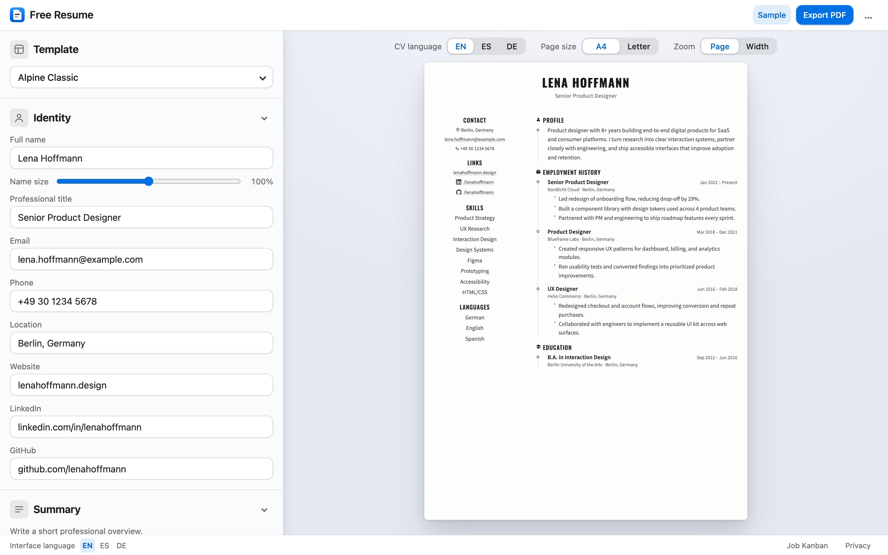
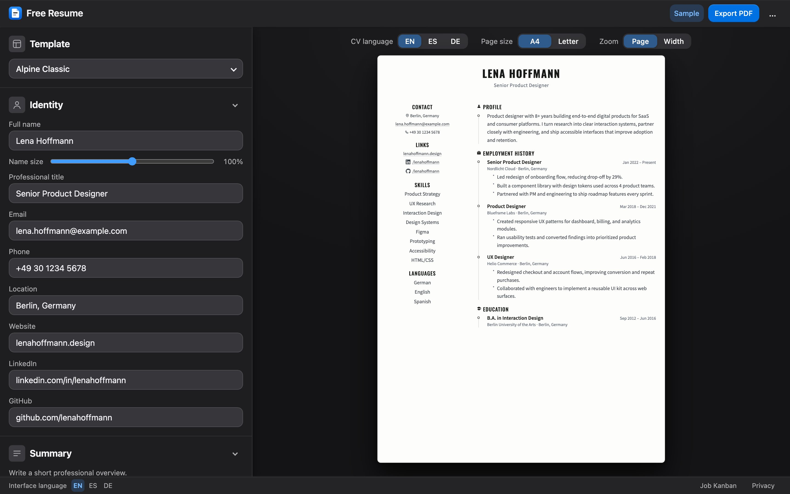
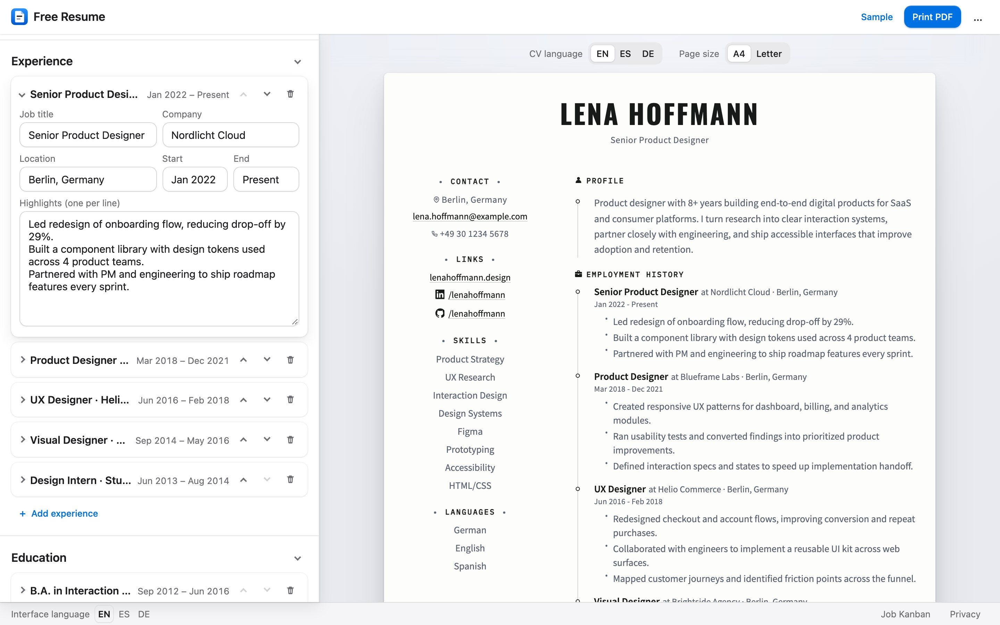
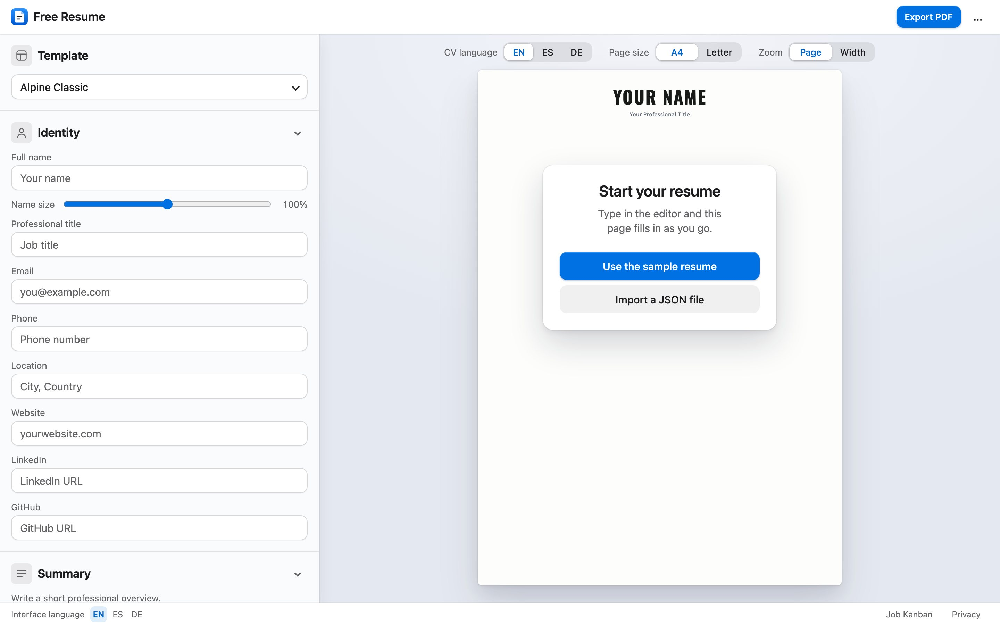
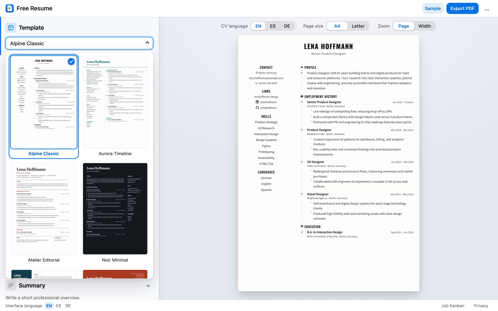
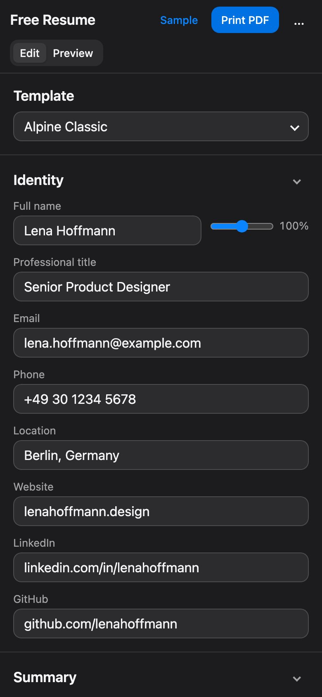
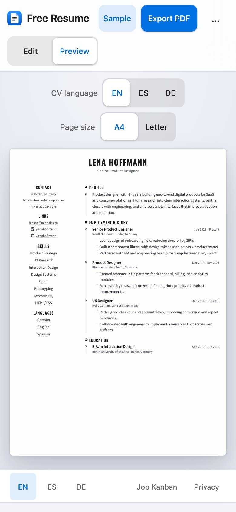

# 📄 Free Resume

A modern, template-driven resume web application.

✨ English, Spanish & German UI · 🌗 Light & dark mode · 🎨 Multiple templates · 🛠️ Skills with per-skill levels

## 📸 Screenshots

<!-- Keep these current: after changing the interface, the templates or the Sample resume, run `node scripts/render-images.mjs` on macOS. It renders docs/screenshots/, the gallery thumbnails and og-image.png from the Sample resume. -->



| Dark mode | Editing an entry |
| --- | --- |
|  |  |

| First run | Template gallery |
| --- | --- |
|  |  |

| Mobile, editing | Mobile, preview |
| --- | --- |
|  |  |

---

## 🚀 Run locally

This project uses native ES modules, so opening `index.html` directly with `file://` won't work. Start a local server instead:

```bash
# Option 1: Python 3
python3 -m http.server 5500

# Option 2: Node
npx serve . -l 5500
```

Or use the **Live Server** extension in VS Code — open `index.html` → **Open with Live Server**.

Then visit `http://localhost:5500`.

## 🧪 Tests

The tests drive the app in headless Chrome and need only Node 22 or later and Chrome. Nothing to install:

```bash
node --test tests/*.test.mjs
```

They check the editor, the template gallery and saved drafts, and that the preview always has as many sheets as the exported PDF has pages, including resumes that end right at a page break. If Chrome isn't found, set `CHROME_PATH` to its binary. The **Test** workflow runs them on every pull request, along with checks that `chrome-extension/` is in sync and that the MCP server in `mcp/` builds and passes its own tests (`cd mcp && npm ci && npm test`).

`tests/cross-browser/` also runs the preview in WebKit (Safari's engine) and Firefox through Playwright. It has its own dependencies:

```bash
cd tests/cross-browser && npm ci && npx playwright install webkit firefox && npm test
```

Set `ENGINES=webkit` or `ENGINES=firefox` to run one engine. Run the WebKit checks on macOS: WebKit on Linux is a different port and doesn't print the way Safari does.

## 🌐 Deploy with GitHub Pages

1. Push this repository to GitHub.
2. In repository settings, set **Pages → Source** to **GitHub Actions**.
3. Push to `main` (or trigger **Deploy Free Resume** manually from Actions).
4. GitHub Actions publishes the site using `.github/workflows/deploy-pages.yml`.
5. At deploy time `scripts/stamp-version.sh` stamps every JS/CSS reference (including module imports) with `?v=<commit SHA>`, so versions are never edited by hand and browsers never mix old and new files.

## 📝 Notes

> [!TIP]
> - The editor starts **blank** intentionally.
> - The skills section appears automatically after you add a skill.
> - Use **Export PDF** to print or save your resume as a PDF file.
> - Use **Export JSON** to save your resume data as JSON, and **Import** to restore it later.

## 🧩 Chrome Extension — LinkedIn Import

The `chrome-extension/` directory contains a Manifest V3 Chrome extension that imports a LinkedIn profile and generates a PDF resume in one click.

### 📥 Installation (developer mode)

1. Open `chrome://extensions` in Chrome.
2. Enable **Developer mode** (top-right toggle).
3. Click **Load unpacked** and select the `chrome-extension/` folder.

### ▶️ Usage

1. Navigate to any LinkedIn profile page (`linkedin.com/in/…`).
2. Click the **Free Resume** extension icon.
3. Choose a template, page size, max skills count, and skills order.
4. Click **Generate PDF** — the extension opens the resume in a new tab ready to print or save.

### 🔍 What gets extracted

| Field | Source |
|---|---|
| 👤 Name, headline, location | Main profile page |
| 📋 Summary / About | Main profile page; falls back to `/details/summary/` |
| 💼 Experience | Main profile page (grouped & single roles) |
| 🎓 Education | Main profile page |
| 🏷️ Skills (up to 30) | `/details/skills/` — fetched in background |
| 🌍 Languages | Main profile page |
| 📧 Email | `/overlay/contact-info/` — mailto or plain-text fallback |
| 📞 Phone | `/overlay/contact-info/` — tel link or plain-text fallback |
| 🔗 Website | `/overlay/contact-info/` — first non-GitHub link |
| 🐙 GitHub | `/overlay/contact-info/` — first `github.com` link |

> [!NOTE]
> Contact info, skills, and about are all fetched in **parallel** background tabs that close automatically after extraction.

### ⚙️ Popup options

| Option | Description |
|---|---|
| **Template** | Any of the 8 Free Resume templates |
| **Page size** | A4 or Letter |
| **Max skills** | Limit the number of skills imported (default 10; 0 = all) |
| **Skills order** | *LinkedIn order* — preserves DOM order; *Top endorsed* — sorts by endorsement count |

## 🤖 MCP server — AI assistants

The `mcp/` directory contains a [Model Context Protocol](https://modelcontextprotocol.io) server. It lets an AI assistant such as Claude write your resume as a Free Resume JSON file, which you then open in the app with **Import** in the **⋯** menu, or **Import a JSON file** on a blank resume. The server runs on your computer and talks to the assistant over stdio. It sends nothing anywhere.

### 📥 Installation

It needs Node 22 or later.

```bash
cd mcp && npm ci && npm run build
```

This builds `mcp/dist/index.js`. Then connect it to your assistant, using the absolute path to that file:

- **Claude Code:**

  ```bash
  claude mcp add free-resume -- node /absolute/path/to/free-resume/mcp/dist/index.js
  ```

- **Claude Desktop, or any other MCP client:** add it to the client's MCP configuration (for Claude Desktop, *Settings → Developer → Edit Config*):

  ```json
  {
    "mcpServers": {
      "free-resume": {
        "command": "node",
        "args": ["/absolute/path/to/free-resume/mcp/dist/index.js"]
      }
    }
  }
  ```

### ▶️ Usage

1. Give the assistant your background (a LinkedIn export, an old resume, or a few notes) and ask it to make a Free Resume file.
2. The assistant builds the file with `create-resume-file`, or writes one following the `generate-resume` prompt and checks it with `validate-resume`.
3. Save its answer as a `.json` file and open it in the app with **Import** in the **⋯** menu.

### 🧰 What it offers

| Kind | Name | What it does |
|---|---|---|
| Tool | `create-resume-file` | Takes the resume's fields and returns a complete file ready to import. If something breaks a limit the app enforces, like a summary over 10,000 characters, it says what to shorten instead. |
| Tool | `validate-resume` | Checks a resume JSON, with or without the export wrapper, and lists every problem. |
| Prompt | `generate-resume` | Instructions for writing a file from career information, in a chosen language (`en`, `es`, `de`) and template. |
| Resource | `free-resume://schema` | The JSON Schema of the file format. |
| Resource | `free-resume://example` | A complete example file. |

It knows the same 8 templates as the app. Files that name the retired Noir or Slate templates still validate and open as Berlin.

### 🧪 Tests

```bash
cd mcp && npm test
```

The tests build the server, check its validation against the app's own (so the server never accepts a file the app rejects), and start it over stdio to call each tool the way an assistant does. CI runs them on every pull request.
